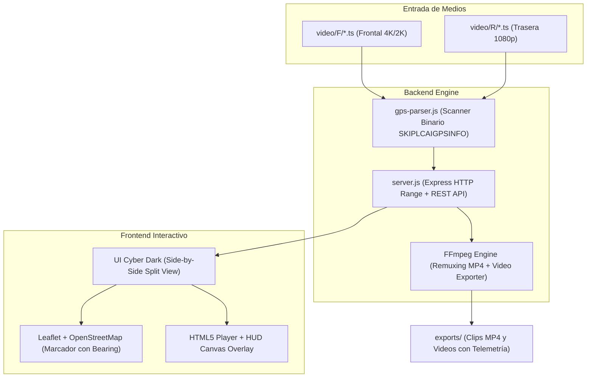

# 🚗 D026 Dashcam Viewer & GPS Route Studio

[](https://github.com/kevin10191992/DashcamViewer/releases)
[](https://github.com/kevin10191992/DashcamViewer)
[](https://nodejs.org)
[](https://www.electronjs.org/)
[](https://www.docker.com/)
[](LICENSE)

Aplicación moderna, ultrarrápida y de código abierto para visualizar, sincronizar con mapas, exportar rutas GPS y convertir grabaciones de la cámara de coche **SEEMOPEN D026 Dashcam** (y dispositivos compatibles con chipset MStar/Sigmastar y formato MPEG-TS con metadatos GPS incrustados).

Desarrollada para ofrecer una alternativa local, gratuita y sin suscripciones a reproductores comerciales de pago (como DVPlayer), permitiendo además la exportación de trayectos unificados completos en **GPX**, **GeoJSON** y **KML**, renderizado de video con telemetría incrustada (**HUD**) y copia amigable de clips a **MP4** instantáneo.

---

## 🌟 Características Principales

- **🛰️ Extracción de GPS Nativa y Ultrarrápida**:
  - Lee directamente el bloque de hardware `SKIPLCAIGPSINFO` y los paquetes de telemetría incrustados al final de cada archivo `.ts`.
  - Escanea **187 clips en menos de 600 ms** (más de 11,800 puntos de ruta procesados de forma instantánea).
  - 100% offline y sin llamadas a servidores de pago ni APIs de terceros.

- **🗺️ Sincronización Bidireccional Video ⇄ OpenStreetMap**:
  - **Side-by-Side (Pantalla Dividida)**: Video y mapa en tiempo real con divisor deslizable (20% a 80%) y botones para maximizar video o mapa al 100%.
  - **Marcador dinámico**: El vehículo avanza en el mapa al reproducir el video, rotando de forma continua según el rumbo exacto registrado por la brújula (`bearing`).
  - **Navegación al clic**: Haz clic sobre cualquier punto del recorrido en el mapa y el reproductor saltará automáticamente al clip y segundo exacto de la grabación.
  - Estilos de mapa integrados: OpenStreetMap Estándar (por defecto) y OSM Humanitario.

- **🎥 Soporte de Cámara Dual (Frontal y Trasera)**:
  - Conmutación instantánea entre cámara delantera (`video/F`) y trasera (`video/R`).
  - Preservación del tiempo de reproducción: no se pierde la posición actual al cambiar de cámara.

- **⚡ Copia Amigable de Clips con Remuxing Instantáneo a MP4**:
  - Olvídate de los nombres crudos de la cámara (ej. `20261108094520_0000053F.ts`).
  - Copia a cualquier carpeta con nombres humanos:
    - 📅 **Fecha/Hora**: `2026-11-08_09h45m20s_Frontal.mp4`
    - ⚡ **Detallado**: `Clip-053_2026-11-08_09h45m_Max59kmh_Frontal.mp4`
    - ✏️ **Personalizado**: el nombre que tú elijas.
  - **Conversión a MP4 en 0.4 segundos** mediante remuxing (`-c copy`) sin pérdida de calidad ni re-compresión.
  - Botón integrado para abrir la carpeta destino en el Explorador de Windows con el archivo seleccionado.

- **🗺️ Exportador de Trayecto Completo**:
  - Unifica todos los clips individuales en una sola ruta de viaje continua.
  - Descarga directa en un clic de:
    - **GPX** (compatible con Strava, Garmin, Google Earth, Relive).
    - **GeoJSON** (ideal para GIS, Mapbox, Leaflet, análisis web).
    - **KML** (visualización 3D en Google Earth).

- **🎬 Exportador de Video con HUD de Telemetría (FFmpeg)**:
  - Genera subtítulos dinámicos de alta definición tipo ASS (Advanced SubStation Alpha) e incrusta un velocímetro digital, brújula cardinal, coordenadas GPS decimales y timestamp sobre el video en 1080p o 4K.

- **🔒 Aislamiento Total de la Cámara**:
  - La tarjeta SD / carpeta original permanece 100% intacta y limpia.
  - No se escriben archivos temporales ni configuraciones dentro de la carpeta de grabaciones.

---

## 🚀 Opciones para Ejecutar la Aplicación

Tienes 3 formas diferentes de correr la aplicación según tu caso de uso:

### Opción 1: Ejecutable Portable o Archivos Desempaquetados (.ZIP) para Windows (Recomendada)
No requiere instalar Node.js, Python, FFmpeg ni dependencias. Todo viene autocontenido. En la pestaña [Releases](https://github.com/kevin10191992/DashcamViewer/releases) encontrarás dos alternativas según tu preferencia:

- 📦 **Archivo `.zip` (Desempaquetado)**: Contiene toda la aplicación lista para extraer y ejecutar directamente (`D026 Dashcam Viewer.exe`). Ideal para máxima velocidad de apertura sin tiempos de extracción temporal en `%TEMP%`.
- ⚡ **Archivo único `.exe` (`D026-Dashcam-Viewer-Portable.exe`)**: Un solo ejecutable portátil que puedes llevar en un pendrive y usar en cualquier PC.

**Cómo usarlo:**
- **Arrastrar y soltar**: Arrastra la carpeta de tu tarjeta SD (la que contiene `video/F` y `video/R`) directamente sobre el ejecutable.
- **O haz doble clic** para abrirlo y usa el botón **⚙️ Configurar Ruta** para seleccionar la carpeta mediante el explorador nativo de Windows.

---

### Opción 2: Como Servidor Web Local (Node.js)

Ideal si eres desarrollador o deseas modificar el código:

1. **Clona el repositorio**:
   ```bash
   git clone https://github.com/kevin10191992/DashcamViewer.git
   cd DashcamViewer
   ```

2. **Instala las dependencias**:
   ```bash
   npm install
   ```

3. **(Opcional en Windows) Descarga FFmpeg estático**:
   ```powershell
   npm run setup:ffmpeg
   ```
   *(Si ya tienes `ffmpeg` en el PATH de tu sistema, este paso no es obligatorio).*

4. **Inicia el servidor**:
   ```bash
   # Iniciando apuntando a una carpeta específica:
   node server.js "D:\Ruta\A\Tu\D026DASHCAM"

   # O usando el archivo por lotes en Windows:
   iniciar.bat "D:\Ruta\A\Tu\D026DASHCAM"
   ```

5. Abre tu navegador en **http://localhost:3000**.

Para ejecutar como ventana de escritorio Electron:
```bash
npm start
```

---

### Opción 3: En un Contenedor Docker (Servidor Web)

Ideal para alojar el visor en un NAS (Synology, QNAP, TrueNAS), servidor casero (Home Assistant, Unraid) o VPS en la nube.

#### Con Docker Compose (Más fácil):
1. Clona el repositorio o copia el archivo `docker-compose.yml`.
2. Edita las rutas de volúmenes en `docker-compose.yml` para apuntar a tus grabaciones:
   ```yaml
   volumes:
     - /ruta/a/tus/grabaciones:/data/dashcam:ro
     - ./exports:/data/exports
   ```
3. Ejecuta:
   ```bash
   docker compose up -d
   ```
4. Ingresa a **http://localhost:3000** o la IP de tu servidor.

#### Con Docker CLI directo:
```bash
# Construir la imagen:
docker build -t d026-dashcam-viewer .

# Ejecutar el contenedor:
docker run -d \
  -p 3000:3000 \
  -v "/mi/carpeta/dashcam:/data/dashcam:ro" \
  -v "$(pwd)/exports:/data/exports" \
  --name dashcam-viewer \
  d026-dashcam-viewer
```

---

## ⚙️ Detección Inteligente de Carpetas

La aplicación detecta automáticamente cualquiera de las siguientes estructuras en la carpeta que le indiques:

1. **Estructura oficial de la tarjeta SD**:
   ```
   D026DASHCAM/
   ├── video/
   │   ├── F/   (Archivos *F.ts)
   │   └── R/   (Archivos *R.ts)
   ├── event/
   └── photo/
   ```
2. **Carpetas directas F y R**:
   ```
   Carpeta/
   ├── F/
   └── R/
   ```
3. **Carpeta plana**: Todos los clips `.ts` mezclados en un solo directorio (la app los clasifica automáticamente por el sufijo `F` y `R`).

---

## 🔄 Pipeline CI/CD en GitHub Actions

El repositorio incluye un flujo automatizado en `.github/workflows/release.yml` para compilar el ejecutable portable y generar un archivo `.zip` de distribución:

### ¿Cómo generar una nueva versión (Release)?
1. Crea un tag de versión y súbelo a GitHub:
   ```bash
   git tag v1.0.0
   git push origin v1.0.0
   ```
2. GitHub Actions se ejecutará automáticamente en un runner de Windows:
   - Descarga e instala dependencias.
   - Descarga una versión limpia de FFmpeg para Windows.
   - Compila la aplicación con `electron-builder`.
   - Empaqueta los archivos desempaquetados de la aplicación en un archivo `D026-Dashcam-Viewer-v1.0.0-Windows-Portable.zip`.
   - Crea un **GitHub Release** público con los archivos adjuntos listos para descarga.
3. También puedes disparar la compilación manualmente en cualquier momento desde la pestaña **Actions** seleccionando el botón **Run workflow**.

---

## 🛡️ Seguridad, Privacidad y Ausencia de Secretos

- **Sin Telemetría Oculta ni APIs de Pago**: El software corre íntegramente de forma local en tu máquina.
- **Sin Secretos en el Código**: No utiliza claves privadas, tokens de autenticación ni contraseñas hardcodeadas.
- **Protección de la Tarjeta SD**: El montaje en Docker se realiza en modo solo lectura (`:ro`) y el backend nunca modifica ni borra los archivos originales de la cámara.
- **.gitignore exhaustivo**: Los directorios de compilación (`dist/`), binarios pesados (`bin/`), caché de transcodificación (`cache_mp4/`), videos exportados (`exports/`) y configuraciones de rutas locales (`config.json`) están excluidos del control de versiones.

---

## 🛠️ Arquitectura Técnica



---

## 📄 Licencia

Este proyecto está bajo la Licencia **MIT**. Consulta el archivo `LICENSE` para más detalles.
